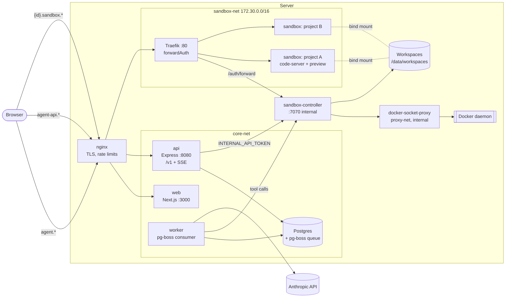

# Software Agent

Software Agent is an AI coding platform. A signed-in user describes what they want to build. The agent (Anthropic Claude, using native tool calls) then plans, writes and runs code inside an isolated per-project sandbox. The user watches the run stream live, opens the project in a browser IDE (code-server), previews the running app, and exports the workspace.

Each project has its own workspace directory with git snapshots of every agent run. Every model action goes through a typed, validated tool that executes inside that project's sandbox container. Nothing the model produces ever runs inside the platform services themselves.

## Architecture



| Service | Package | Port | Exposure | Role |
|---|---|---|---|---|
| `apps/web` | `@repo/web` | 3000 (host 127.0.0.1:3010) | public via nginx | Only browser-facing app. Next.js standalone build. |
| `apps/api` | `api` | 8080 | public via nginx | Only public API: `/v1/*` REST, SSE at `/v1/runs/:id/events`, `/health`, `/ready`. |
| `apps/worker` | `worker` | 9091 (`/health` only) | none | Consumes pg-boss jobs and runs the agent loop. |
| `apps/sandbox-controller` | `sandbox-controller` | 7070 | internal only | Owns sandbox lifecycle, workspace files and exec. It is the only service that talks to Docker, and only through the socket proxy. Also serves Traefik `forwardAuth` at `/auth/forward`. |
| `apps/sandbox-image` | – | – | via Traefik | Generic code-server image used for every project sandbox. |

Design decisions are recorded in [`docs/adr/`](docs/adr). Security posture is described in [`docs/threat-model.md`](docs/threat-model.md).

## Repository layout

```
apps/
  web/                 Next.js frontend (@repo/web)
  api/                 Public Express API (/v1, SSE)
  worker/              pg-boss consumer running the agent loop
  sandbox-controller/  Docker (via socket proxy) + workspace owner
  sandbox-image/       code-server sandbox Dockerfile
packages/
  contracts/           zod schemas + types shared by every service (API, events, controller)
  auth/                Clerk JWT verification, internal-token middleware, ownership helpers
  agent-core/          Agent loop, tool definitions, providers (Anthropic + fake)
  observability/       Logging, request IDs, Sentry
  db/                  Prisma schema, migrations, client
  typescript-config/   Shared tsconfig
  eslint-config/       Shared ESLint config
deploy/                nginx site config + deployment notes
scripts/               deploy, rollback, backup, smoke-test, bootstrap-server
docs/                  ADRs, threat model, runbook, cutover plan
Dockerfile             Multi-stage build for api, worker, sandbox-controller, web, migrate
docker-compose.yml     Production stack
```

## Local development

Requirements: Node 20+, pnpm 9 (`corepack enable`), Docker.

```bash
pnpm install
cp .env.example .env                      # fill in Clerk + Anthropic keys, a Postgres password,
                                          # and INTERNAL_API_TOKEN (openssl rand -hex 32)
                                          # use localhost in DATABASE_URL for host-run services

docker compose up -d --wait postgres      # or any local Postgres 16
pnpm --filter db migrate                  # prisma migrate dev + generate

# Sandboxes need the shared network and a sandbox image:
docker network create --subnet 172.30.0.0/16 --ip-range 172.30.128.0/17 software-agent_sandbox-net
docker build -t software-agent-sandbox:dev apps/sandbox-image   # then SANDBOX_IMAGE=software-agent-sandbox:dev

pnpm dev                                  # turbo: web, api, worker, sandbox-controller
```

To run the whole containerised stack locally instead, run `docker compose build && docker compose up -d`. Set `HOST_WORKSPACE_ROOT` to a local directory first.

## Commands

| Command | What it does |
|---|---|
| `pnpm install` | Install all workspace dependencies |
| `pnpm --filter db migrate` | Create/apply a dev migration and regenerate the Prisma client |
| `pnpm --filter db migrate:deploy` | Apply committed migrations (what `db-migrate` runs in production) |
| `pnpm dev` | Run every app in watch mode |
| `pnpm test` | Unit and regression tests (vitest) across the monorepo |
| `pnpm check-types` / `pnpm lint` | Type check and lint |
| `pnpm build` | Build every package and app (`tsc` to `dist/`, Next.js for web) |

## Deploy and operations

- **Deploy:** pushing to `main` runs CI. When CI passes, [`.github/workflows/deploy.yml`](.github/workflows/deploy.yml) builds and pushes images to GHCR tagged with the commit SHA, then runs [`scripts/deploy.sh <sha>`](scripts/deploy.sh) on the server as the non-root deploy user. That script backs up the database, runs migrations, starts the stack and runs the smoke tests.
- **Rollback:** run [`scripts/rollback.sh`](scripts/rollback.sh), which returns to the previously deployed tag.
- **Backups:** [`scripts/backup.sh`](scripts/backup.sh) runs nightly (Postgres dump plus a workspace tarball, 14-day retention, optional off-site copy with rclone).
- **First server setup:** run [`scripts/bootstrap-server.sh`](scripts/bootstrap-server.sh). See [`deploy/README.md`](deploy/README.md).
- **Operations:** see the [runbook](docs/runbook.md) and the [cutover from the old stack](docs/cutover.md).

Contributor and agent rules are in [`AGENTS.md`](AGENTS.md).
